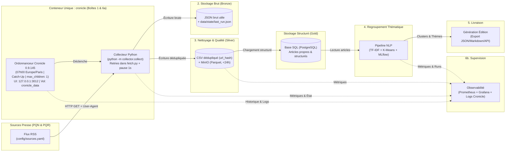

# Note de Cadrage Projet « La gazette » (M2Ops)

**Module :** M2Ops · M2-DE2  
**Compétence visée :** C7.1 Veille technologique, choix argumenté des outils de containerisation et d’ordonnancement  
**Équipe :** Vincent & Lucas  
**Date :** 13 novembre 2026  

---

## 1. Contexte et Reformulation du Besoin

Le projet **« La gazette »** consiste à concevoir et industrialiser un pipeline de données automatisé, reproductible et observable. Le système doit collecter les publications récentes (moins de 24 heures) issues d'un panel représentatif de la Presse Quotidienne Nationale (**PQN**) et Régionale (**PQR**).

L'objectif métier est de produire une édition matinale synthétique permettant d'identifier rapidement les grandes thématiques d'actualité qui occupent les rédactions, en associant chaque sujet aux sources qui le traitent et en redirigeant le lecteur vers les articles originaux.

---

## 2. Périmètre du Projet (Bornage)

### Ce qui est dans le périmètre (IN)
* **Collecte automatisée et idempotente** via des canaux publics autorisés (flux RSS officiels configurés dans `config/sources.yaml`) sur au moins 4 sources PQN et 4 sources PQR.
* **Extraction stricte des métadonnées** : titre, extrait (chapô/description), lien URL canonique (haché via `url_hash` pour le dédoublonnage) et date de publication.
* **Architecture de stockage en couches** (Bronze, Silver, Gold) et suivi d'état (`data/state/last_run.json`) garantissant la traçabilité et la qualité des données (dédoublonnage sur `url_hash`, filtrage temporel `< 24h`, normalisation).
* **Regroupement thématique (Clustering NLP)** non supervisé pour identifier les sujets du jour.
* **Orchestration quotidienne avec rattrapage (Catch-Up)** : exécution conteneurisée embarquant le planificateur et le collecteur sans dépendance au socket Docker hôte.
* **Observabilité complète** (logs d'exécution dans Cronicle, métriques, alertes) pour garantir la fiabilité de l'édition matinale.

---

## 3. Contraintes et Exigences Non-Fonctionnelles

* **Temporelle (SLA) & Rattrapage :** L'édition est déclenchée chaque jour à **09h10 (Europe/Paris)**. Grâce à l'option **Run All (Catch-Up)** de Cronicle, si la machine hôte est éteinte à 09h10, les runs manqués sont automatiquement relancés au redémarrage. La collecte étant strictement idempotente (dédoublonnage sur `url_hash`), les rattrapages ne génèrent aucun doublon. Seuls les articles de moins de **24 heures** sont retenus.
* **Légale et Éthique :** Respect strict des conditions générales d'utilisation (CGU) des éditeurs (usage non commercial), en-tête `User-Agent` clair et explicite, et temporisation obligatoire (**pause de 1 seconde** entre chaque source). Zéro donnée personnelle.
* **Sécurité :** L'interface web de Cronicle (`http://localhost:3012`) est publiée uniquement sur l'interface locale (`127.0.0.1`), protégée par mot de passe (`CRONICLE_ADMIN_PASSWORD` injecté via `.env` non versionné, remplaçant le mot de passe par défaut `admin/admin` dès le premier démarrage). Aucun accès à `/var/run/docker.sock` n'est requis.
* **Budgétaire (FinOps) :** Budget **0 €**. Développement et exécution initiale sur les machines locales de l'équipe (Docker), avant migration sur l'infrastructure fournie par l'école (TD 4/6).
* **Reproductibilité :** Versions épinglées (ex. `CRONICLE_VERSION=0.9.145`), initialisation automatisée au démarrage (`entrypoint.sh` + `docker/bootstrap_event.py`) et déploiement via Git et Docker.

---

## 4. Architecture Cible (Pipeline en 6 Boîtes)

Le pipeline s'articule autour d'une architecture conteneurisée modulaire, où la collecte et l'ordonnancement cohabitent au sein d'un conteneur unique (`cronicle`) pour éliminer toute contrainte de sécurité liée au socket Docker :

---

## 5. Choix Techniques (Veille C7.1) et Alternatives Écartées

### 5.1. Récupération de la presse (Collecte)
* **Stack retenue :** **Flux RSS** configurés dans `config/sources.yaml` et traités par le module Python `collector.collect` (avec script de vérification `check_feeds` et gestion des relances HTTP directement intégrée dans `fetch.py`).
* **Justification :** Format XML standardisé, léger, structuré nativement autour des champs attendus (titre, résumé, lien, date) et mis à disposition par les éditeurs. L'encapsulation des retries dans `fetch.py` permet une gestion fine des erreurs réseau par flux sans relancer l'intégralité du job.
* **Alternatives écartées :**
  * *RSS.app (générateur de flux tiers)* : Agit comme un intermédiaire (*middleman*) externe entre les éditeurs et notre pipeline. Cela introduit une dépendance à un service tiers (risque de coupure, limitation de requêtes ou passage en modèle payant), réduit la maîtrise directe des conditions d'accès éditeurs et contourne l'utilisation des flux officiels natifs.
  * *Web Scraping HTML (BeautifulSoup/Playwright)* : Fragile aux changements de DOM, lent et non conforme aux CGU des éditeurs.
  * *APIs propriétaires payantes* : Hors budget (contrainte 0 €).

### 5.2. Ordonnancement et Architecture de la Tâche 1
* **Stack retenue :** **Conteneur unique `cronicle` (Cronicle `0.9.145` + Python)**.
  * *Initialisation automatique :* Au premier démarrage, `entrypoint.sh` initialise Cronicle (remplacement du mot de passe par défaut via `CRONICLE_ADMIN_PASSWORD`) et `docker/bootstrap_event.py` crée automatiquement l'événement **`Gazette : collecte quotidienne`** (tous les jours à `07h00 Europe/Paris`, commande `python -m collector.collect`, `max_children: 1` pour garantir un seul run simultané, `0` relance côté Cronicle car gérées dans `fetch.py`, et option **Run All / Catch-Up** activée).
* **Justification :** Embarquer Python et Cronicle dans le même conteneur évite d'avoir à monter le socket Docker (`/var/run/docker.sock`), supprimant ainsi une faille de sécurité majeure. De plus, l'interface web (`http://localhost:3012`) fournit nativement l'historique et les logs de chaque run.
* **Alternatives écartées :**
  * *Ofelia* : Nécessite un accès direct au socket Docker (`/var/run/docker.sock`) pour piloter des conteneurs frères, ce qui pose des problèmes de sécurité et de droits sur l'infrastructure cible.
  * *Apache Airflow* : Trop gourmand en ressources (RAM/CPU) pour une exécution batch quotidienne légère.
  * *Crontab Linux standard* : Absence d'interface de suivi, de gestion native du rattrapage (*Catch-Up*) sur machine éteinte et de verrouillage d'exécution (`max_children: 1`).

### 5.3. Stockage (Architecture Médaillon)
* **Stack retenue :** **JSON brut utile + `last_run.json` (Bronze)** $\rightarrow$ **CSV dédupliqué sur `url_hash` & MinIO (Silver)** $\rightarrow$ **Base SQL / PostgreSQL (Gold)**.
* **Justification :**
  * *Bronze (JSON brut utile)* : Conservation des données brutes issues des flux RSS ainsi que l'état d'exécution dans `data/state/last_run.json`.
  * *Silver (CSV dédupliqué sur `url_hash` + MinIO)* : Le calcul d'une empreinte `url_hash` garantit l'idempotence parfaite du pipeline (indispensable avec l'option *Catch-Up* de Cronicle). MinIO assure ensuite le stockage objet compatible S3 à coût zéro.
  * *Gold (SQL)* : Base relationnelle robuste pour structurer les clusters thématiques et servir l'édition finale.
* **Alternatives écartées :**
  * *Data Warehouse Cloud (BigQuery/Snowflake)* : Coût potentiel et dépendance réseau externe.

### 5.4. Regroupement par thèmes (NLP & MLOps)
* **Stack retenue :** Pipeline **TF-IDF + K-Means** suivi et versionné avec **MLflow**.
* **Justification :** Approche rapide, déterministe, explicable (extraction des mots-clés les plus pondérés par cluster) et très peu gourmande en CPU/RAM. **MLflow** permet de tracer les paramètres (nombre de clusters $k$, scores de silhouette) et de garantir la reproductibilité.
* **Alternatives écartées :**
  * *BERTopic* : Bien qu'il réalise l'extraction de thèmes en une seule passe avec une grande finesse sémantique, l'utilisation de modèles Transformers nécessite trop de RAM/GPU et allonge le temps de traitement sur CPU local.
  * *Appels API LLM* : Hors budget et interdit par le cahier des charges.

### 5.5. Supervision et Observabilité
* **Stack retenue :** **Prometheus + Grafana** complétés par l'**interface web Cronicle** (`127.0.0.1:3012`).
* **Justification :** Cronicle fournit le suivi opérationnel immédiat des exécutions quotidiennes (logs stdout/stderr, statut des runs, rattrapages), tandis que Prometheus et Grafana assurent la collecte des métriques techniques et métiers (volumétrie par source, taux de dédoublonnage, alertes).
* **Alternatives écartées :**
  * *Stack ELK (Elasticsearch, Logstash, Kibana)* : Trop lourde en mémoire pour un environnement local.

### 5.6. Infrastructure as Code (IaC) & Conteneurisation
* **Stack retenue :** **Docker & Docker Compose** avec persistance via volumes nommés (`cronicle_data`, volumes MinIO/PostgreSQL) et configuration externalisée (`.env`, `config/sources.yaml`).
* **Justification :** Déploiement reproductible en une commande (`docker compose up -d`), isolation des services et absence de privilèges élevés requis sur l'hôte (pas de montage du socket Docker).
* **Alternatives écartées :**
  * *Kubernetes (K8s)* : Complexité opérationnelle disproportionnée pour ce périmètre.

---

## 6. Sources Sélectionnées (Aperçu `sources.csv` / `config/sources.yaml`)

Conformément aux exigences (minimum 4 PQN et 4 PQR), voici les 8 flux RSS identifiés et vérifiés manuellement (panel presse anglophone/américaine permettant de valider l'homogénéité linguistique pour le clustering TF-IDF) :

| Nom | Type | Région | Accès (Flux RSS) | Conditions & Notes |
| :--- | :--- | :--- | :--- | :--- |
| **The New York Times** | PQN | National (USA) | Flux RSS officiels (via annuaire NYT/Feeder) | Usage non-commercial, métadonnées (titre, résumé, lien) uniquement. |
| **The Washington Post** | PQN | National (USA) | Flux RSS officiels (via annuaire WaPo/Feeder) | Lecture automatisée autorisée pour syndication de titres/extraits. |
| **The Wall Street Journal** | PQN | National (USA) | `https://feeds.content.dowjones.io/public/rss/RSSWorldNews` | Flux public Dow Jones, mise à jour continue. |
| **New York Post** | PQN | National (USA) | `https://nypost.com/feed/` | Flux RSS WordPress standard, haute fréquence de publication. |
| **Los Angeles Times** | PQR | Californie (Ouest) | Flux RSS LA Times (via annuaire Feeder) | Presse régionale majeure, filtrage `< 24h` requis. |
| **The Plain Dealer** | PQR | Cleveland / Ohio | `https://www.cleveland.com/arc/outboundfeeds/rss/` | Flux Arc Publishing structuré, mise à jour horaire. |
| **The Seattle Times** | PQR | Washington (Nord-Ouest) | `https://www.seattletimes.com/seattle-news/feed/` | Flux local dédié à l'actualité de Seattle. |
| **Houston Chronicle** | PQR | Texas (Sud) | `https://www.chron.com/rss/feed/News-270.php` | Flux régional Hearst, encodage XML standard. |

*(Note : Les URLs directes exactes et paramètres de collecte sont consignés dans `sources.csv` pour le livrable de cadrage et dans `config/sources.yaml` pour l'exécution du collecteur).*

---

## 7. Analyse des Risques et Mesures d'Atténuation

| Risque identifié | Probabilité | Impact | Mesure d'atténuation (Mitigation) |
| :--- | :--- | :--- | :--- |
| **Sécurité & Privilèges Docker (Socket hôte)** | Faible | Élevé | **Risque éliminé par conception** : Cronicle et le collecteur Python tournent dans le même conteneur. Aucun accès à `/var/run/docker.sock` n'est nécessaire (aucune dérogation admin EFREI requise). |
| **Exposition de l'interface web Cronicle** | Faible | Élevé | Port `3012` publié exclusivement sur `127.0.0.1` (non exposé sur le réseau sans HTTPS). Mot de passe par défaut `admin/admin` remplacé dès le 1er démarrage via `CRONICLE_ADMIN_PASSWORD` (`.env` exclu de Git). |
| **Maintenance de Cronicle (Mainteneur unique)** | Moyenne | Moyen | Version épinglée via l'argument de build `CRONICLE_VERSION=0.9.145` pour garantir la stabilité des builds, associée à une veille sur les correctifs de sécurité. |
| **Perte de l'historique Cronicle (`cronicle_data`)** | Moyenne | Faible | Le planning et les logs sont persistés dans le volume `cronicle_data`. En cas de suppression (`docker compose down -v`), `bootstrap_event.py` recrée automatiquement l'événement au redémarrage, bien que l'historique passé soit perdu. |
| **Obsolescence des URLs RSS & Blocage éditeur** | Moyenne | Moyen | Utilisation de l'outil `check_feeds` pour détecter les flux périmés, gestion des retries dans `fetch.py`, usage strictement non commercial, `User-Agent` clair et **pause de 1 seconde** entre chaque source. |
| **Doublons lors des rattrapages (Catch-Up)** | Élevée | Moyen | En cas d'extinction de la machine à 07h00, Cronicle (*Run All*) relance les runs manqués au démarrage. L'idempotence est garantie par le dédoublonnage systématique sur `url_hash` dans la couche Silver. |

---

## 8. Organisation de l'Équipe et Répartition des Rôles

L'équipe est composée de deux membres qui se répartissent la conception, le développement et la veille technique des six briques :

* **Lucas :**
  * **Sujet 1 — Collecte :** Développement du module `collector.collect`, gestion des retries dans `fetch.py`, script `check_feeds`, respect des CGU (pause 1s, `User-Agent`) et alimentation de la couche Bronze (`JSON` + `last_run.json`).
  * **Sujet 2 — Ordonnancement :** Configuration de Cronicle `0.9.145`, scripts d'initialisation (`entrypoint.sh`, `docker/bootstrap_event.py`), paramétrage du planning quotidien (`07h00 Europe/Paris`) et de l'option *Catch-Up*.
  * **Sujet 6 — Infrastructure as Code :** Rédaction du `Dockerfile` unifié (Python + Cronicle), du `docker-compose.yml` global, gestion des secrets (`.env`) et persistance des volumes (`cronicle_data`).

* **Vincent :**
  * **Sujet 3 — Stockage & Qualité :** Implémentation du dédoublonnage sur `url_hash` (Silver CSV), déploiement de MinIO et de la base SQL (Gold), et filtrage temporel (`< 24h`).
  * **Sujet 4 — Regroupement thématique (NLP) :** Conception du pipeline TF-IDF + K-Means et instrumentation des expériences via MLflow.
  * **Sujet 5 — Supervision :** Configuration de la stack Prometheus + Grafana, exposition des métriques applicatives et création des tableaux de bord d'alerte.